# TaskGo — UI Problems, Frontend Bugs & Interface Defects Analysis

**Date:** October 31, 2026  
**Application:** TaskGo (Hyperlocal Neo-Brutalist Errand Runner for Kozhikode)  
**Stack:** React Native (0.88.1) / Expo (~58.0.21) / TypeScript (~6.0.3) / Zustand (5.0.16) / React Navigation (v7)

---

## 1. Executive Summary

A comprehensive, line-by-line audit of the entire TaskGo codebase was conducted across **13 screens**, **12 reusable UI components**, **navigation structures**, **state stores**, **simulation utilities**, and **theme configurations**.

While the application features an engaging neo-brutalist aesthetic with custom hard black drop shadows, bright palette accents, and realistic hyperlocal Kozhikode seed data, it suffers from several **critical runtime bugs, data-loss regressions, memory leaks, raw enum text leaks (underscores displayed to end-users), misaligned and overlapping button layouts, navigation stacking flaws, accessibility non-compliance, and cross-platform UI glitches** (specifically on iOS notch devices and Android soft keyboard handling).

This document serves as the complete audit report and actionable remediation backlog.

---

## 2. Raw System Enums & Underscores Leaked to UI

Across multiple screens, internal database enum keys with raw underscores (`_`) and screaming snake-case formatting are rendered directly to end-users instead of clean, human-readable labels.

```
Current Raw Text Leaked to User       Should Be Formatted As
────────────────────────────────────────────────────────────────────────
AWAITING_DEPOSIT                      Awaiting Deposit / Deposit Needed
IN_PROGRESS                           In Progress
PROOF_SUBMITTED                       Proof Submitted / Review Proof
AWAITING_FINAL_PAYMENT                Final Payment / Awaiting Settlement
ITEMS_PURCHASED_OR_COLLECTED          Items Purchased / Collected
ON_THE_WAY                            On The Way / En Route
TASKBOY                               Task Boy / Runner
COUNTERED                             Counter Offer
PENDING                               Pending Response
COMPLETED & SETTLED                   Completed & Settled
```

### Specific Instances in Code:

1. **`CustomerDashboardScreen.tsx` (Lines 71, 95, 138, 280):**
   - **Line 71 & Line 280:** `<BrutalBadge label={activeOrder.status} ... />` and `<BrutalBadge label={order.status} ... />` directly pass raw order status strings. Users see `AWAITING_DEPOSIT`, `IN_PROGRESS`, `PROOF_SUBMITTED`, and `AWAITING_FINAL_PAYMENT` inside badges.
   - **Line 95:** Displays `Step: {activeOrder.progressStep ?? 'On The Way'}`. When the runner marks step 2, the user literally reads:  
     `Step: ITEMS_PURCHASED_OR_COLLECTED`
   - **Line 138:** Displays:  
     `Lifecycle Step: {activeOrder.status} ({activeOrder.progressStep ?? 'En route'})`  
     This renders as: `Lifecycle Step: IN_PROGRESS (ITEMS_PURCHASED_OR_COLLECTED)`. This exposes raw backend state to non-technical users.

2. **`OrderDetailScreen.tsx` (Lines 91 & 254):**
   - **Line 91:** Top bar status badge renders `<BrutalBadge label={order.status} color={STATUS_BADGE_COLORS[order.status]} />`, printing raw underscored statuses.
   - **Line 254:** In the live tracking card:  
     `Status: {order.progressStep ?? 'Dispatched'}`  
     Renders `Status: ITEMS_PURCHASED_OR_COLLECTED` or `Status: ON_THE_WAY`.

3. **`MyErrandsScreen.tsx` (Line 287):**
   - Active errands list renders `<BrutalBadge label={order.status} color="#14B8A6" />`, displaying `AWAITING_DEPOSIT`, `PROOF_SUBMITTED`, etc. on runner task cards.

4. **`RunnerNegotiationScreen.tsx` (Line 329):**
   - Status text prints:  
     `Status: {order.status}. Awaiting customer's advance deposit to dispatch you.`  
     This literally reads: `Status: AWAITING_DEPOSIT. Awaiting customer's advance deposit to dispatch you.`

5. **`CustomerProfileScreen.tsx` (Line 33):**
   - User role badge renders `<BrutalBadge label={currentUser?.role ?? 'USER'} color="#8B5CF6" />`. While `AppHeader.tsx` maintains a `ROLE_LABELS` lookup mapping `TASKBOY` to `"Task Boy"`, the profile screen omits this and prints `TASKBOY`.

6. **`NegotiationThreadScreen.tsx` (Lines 119 & 186):**
   - Badge displays `Thread: {thread.status}` (`Thread: OPEN`, `Thread: AGREED`, `Thread: LOST`) and offer badge displays raw `offer.status` (`COUNTERED`, `PENDING`, `ACCEPTED`, `REJECTED`).

### Remediation:
Create a centralized text formatting helper in [`src/utils/format.ts`](file:///home/notnoel/Projects/taskgo/src/utils/format.ts):
```typescript
export const STATUS_LABELS: Record<OrderStatus, string> = {
  PLACED: 'Looking for Task Boys',
  BIDDING: 'Bids Received',
  AGREED: 'Deal Locked',
  AWAITING_DEPOSIT: 'Advance Deposit Needed',
  ASSIGNED: 'Task Boy Dispatched',
  IN_PROGRESS: 'In Progress',
  PROOF_SUBMITTED: 'Proof Under Review',
  AWAITING_FINAL_PAYMENT: 'Final Payment Pending',
  COMPLETED: 'Completed & Settled',
  CANCELLED: 'Cancelled',
};

export const PROGRESS_STEP_LABELS: Record<ProgressStep, string> = {
  ARRIVED: 'Arrived at Store',
  ITEMS_PURCHASED_OR_COLLECTED: 'Items Purchased / Collected',
  ON_THE_WAY: 'On The Way to Dropoff',
};

export const ROLE_LABELS: Record<UserRole, string> = {
  CUSTOMER: 'Customer',
  TASKBOY: 'Task Boy',
  ADMIN: 'Admin',
};
```
Use these mappings everywhere instead of rendering raw string constants.

---

## 3. Misaligned, Overlapping & Colliding Buttons

The app's custom neo-brutalist button shadow mechanics (`BrutalButton.tsx`) and flexbox row layouts cause multiple visual collision bugs across screens:

### 3.1. Asymmetric Button Inset Inside Cards (4px Leftward Shift)
- **Files:** [`src/components/BrutalButton.tsx`](file:///home/notnoel/Projects/taskgo/src/components/BrutalButton.tsx#L97-L105) & [`src/components/BrutalCard.tsx`](file:///home/notnoel/Projects/taskgo/src/components/BrutalCard.tsx#L70)
- **Problem:** `BrutalButton` applies `{ marginBottom: SHADOW_OFFSET, marginRight: SHADOW_OFFSET, alignSelf: fullWidth ? 'stretch' : 'flex-start' }` where `SHADOW_OFFSET = 4`. When a `fullWidth` button is placed inside a `BrutalCard` with uniform internal padding (e.g. `padding: 18`), the button's right edge incurs an extra 4px margin while the left edge has 0px margin.
- **Visual Impact:** The button appears visibly crooked and lopsided inside the card: the left gap from the card border is 18px, but the right gap is 22px (18px + 4px).

### 3.2. Multi-Button Flex Rows With Shadow Overlap & Boundary Bleed
- **Files:**
  - [`src/screens/customer/NegotiationThreadScreen.tsx`](file:///home/notnoel/Projects/taskgo/src/screens/customer/NegotiationThreadScreen.tsx#L280-L300): "Send Counter" & "Reject Bid"
  - [`src/screens/customer/ProofReviewScreen.tsx`](file:///home/notnoel/Projects/taskgo/src/screens/customer/ProofReviewScreen.tsx#L305-L325): "Cancel" & "Submit Flag"
  - [`src/screens/runner/RunnerNegotiationScreen.tsx`](file:///home/notnoel/Projects/taskgo/src/screens/runner/RunnerNegotiationScreen.tsx#L250-L265): "Send Counter" & "Reject Offer"
  - [`src/components/RunnerBidSheet.tsx`](file:///home/notnoel/Projects/taskgo/src/components/RunnerBidSheet.tsx#L315-L335): "Edit Bid" & "Withdraw"
- **Problem:** Two `BrutalButton` components are placed in `<View style={{ flexDirection: 'row', gap: 10 }}>`, with each button wrapped in `<View style={{ flex: 1 }}>`. Because `BrutalButton`'s internal shadow View has `{ position: 'absolute', right: -4, bottom: -4 }`, the left button's hard black drop shadow bleeds 4px into the 10px flex gap between the buttons, while the right button's shadow overflows the card/screen boundary.
- **Visual Impact:** Buttons look crowded, and the hard black shadow of the left button encroaches into the space of the right button.

### 3.3. Multiline Button Label Left-Alignment Inside Centered Pills
- **File:** [`src/components/BrutalButton.tsx`](file:///home/notnoel/Projects/taskgo/src/components/BrutalButton.tsx#L130-L145)
- **Problem:** `BrutalButton`'s inner `Text` component lacks `textAlign: 'center'`. When long button labels wrap on smaller screens:
  - `"Cancel Errand (Advance Forfeited)"` ([`OrderDetailScreen.tsx:456`](file:///home/notnoel/Projects/taskgo/src/screens/customer/OrderDetailScreen.tsx#L456))
  - `"Confirm Cash Received (Demo Simulate)"` ([`FinalPaymentScreen.tsx:251`](file:///home/notnoel/Projects/taskgo/src/screens/customer/FinalPaymentScreen.tsx#L251))
  - `"ACCEPT ₹150 & LOCK RUNNER"` ([`NegotiationThreadScreen.tsx:273`](file:///home/notnoel/Projects/taskgo/src/screens/customer/NegotiationThreadScreen.tsx#L273))
  - `"APPROVE PROOF & PAY BALANCE →"` ([`ProofReviewScreen.tsx:266`](file:///home/notnoel/Projects/taskgo/src/screens/customer/ProofReviewScreen.tsx#L266))
- **Visual Impact:** The wrapped text defaults to left-aligned inside the pill container, looking unbalanced and poorly typeset.

### 3.4. Pill Corner Text Clipping on Wrapped Button Labels
- **File:** [`src/components/BrutalButton.tsx`](file:///home/notnoel/Projects/taskgo/src/components/BrutalButton.tsx#L90)
- **Problem:** `borderRadius: BORDER_RADIUS.pill` (9999) is hardcoded on `BrutalButton`. When a button label wraps from 1 line to 2 lines, the button expands vertically (e.g. from 44px to 68px). However, the pill caps retain a huge curvature, causing the text on the second line to physically collide with and clip against the curved lower corners of the button surface.
- **Fix:** Use `borderRadius: 14` or `BORDER_RADIUS.card` (16) for buttons, or provide a `radius` prop instead of forcing `9999` pill radius on all buttons.

### 3.5. Disabled Button Semi-Transparent Surface Over Solid Black Shadow
- **File:** [`src/components/BrutalButton.tsx`](file:///home/notnoel/Projects/taskgo/src/components/BrutalButton.tsx#L92)
- **Problem:** When `disabled={true}`, `opacity: 0.5` is applied to the button surface (`surface`), but the shadow View behind it (`zIndex: 0`) remains solid `#000000` with 100% opacity.
- **Visual Impact:** The semi-transparent surface allows the solid black shadow beneath to darken through, producing a muddy, glitchy appearance instead of a standard clean disabled state. Furthermore, the solid black shadow continues to make the disabled button look like an active, elevated button.
- **Fix:** Apply `opacity: disabled ? 0.4 : 1` to the outer container so that both the surface and its shadow fade together, or hide the shadow when disabled (`display: disabled ? 'none' : 'flex'`).

### 3.6. Header Admin Row Overflow on 360–375px Screens
- **File:** [`src/components/AppHeader.tsx`](file:///home/notnoel/Projects/taskgo/src/components/AppHeader.tsx#L115-L160)
- **Problem:** Row 2 of `AppHeader` renders:
  `[Mode: [Customer Mode | Task Boy Mode] ]` + `[SIM: ON/OFF]` in a single `flexDirection: 'row'` with `justifyContent: 'space-between'`.
  - Mode label + gap: ~40px
  - Customer Mode segment: ~110px
  - Task Boy Mode segment: ~110px
  - Borders: ~6px
  - SIM toggle button: ~65px
  - Header horizontal padding: 32px (16px * 2)
  - **Total required width:** ~363–368px.
- **Visual Impact:** On standard 360px Android devices (e.g. Galaxy A-series, standard Android devices) and iPhone SE (375px), this row overflows the screen. The SIM toggle button is clipped off the right screen edge or forced into an awkward wrapped alignment.

### 3.7. 5-Star Rating Buttons Overflow Card Boundaries
- **File:** [`src/screens/customer/ReceiptScreen.tsx`](file:///home/notnoel/Projects/taskgo/src/screens/customer/ReceiptScreen.tsx#L340-L365)
- **Problem:** Five star rating buttons are laid out in a flex row:
  - 5 star touchables: Each has `size={28}`, `padding: 10` on each side, `borderWidth: 3` on each side = 54px width per button. 5 × 54px = 270px.
  - 4 gaps between buttons at 10px = 40px.
  - Total stars row width = 310px.
  - Inside card padding (36px) + screen padding (32px) = 68px.
  - **Total required width:** 378px.
- **Visual Impact:** On iPhone SE (375px) and 360px Android devices, the 5 stars exceed the viewport width. The 5th star is pushed off-screen or wraps onto a second row, leaving 4 stars on top and 1 lonely star below.

---

## 4. Top Critical Bugs & Logic Flaws (P0)

### 4.1. Customer Issue Note Discarded (Data Loss Bug)
- **File:** [`src/screens/customer/ProofReviewScreen.tsx`](file:///home/notnoel/Projects/taskgo/src/screens/customer/ProofReviewScreen.tsx#L50-L58) & [`src/store/index.ts`](file:///home/notnoel/Projects/taskgo/src/store/index.ts#L560-L568)
- **Problem:** When a customer flags an issue with completion proof or a receipt, they write an explanation into `issueNote`. However, `handleRaiseIssue` calls `raiseIssue(orderId)` without passing `issueNote`. In `src/store/index.ts`, `raiseIssue` only sets `issueFlagged: true` and takes no note parameter. The customer's written reason is permanently discarded, and neither the runner nor the admin can ever see what was wrong.
- **Fix:** Update store action `raiseIssue: (orderId: string, note: string) => void` to save `issueNote: string` onto the order model, and pass `issueNote.trim()` in `ProofReviewScreen.tsx`.

### 4.2. Payment State Corruption & Double Payment Reconciliation
- **File:** [`src/screens/customer/FinalPaymentScreen.tsx`](file:///home/notnoel/Projects/taskgo/src/screens/customer/FinalPaymentScreen.tsx#L43-L46) & [`src/store/index.ts`](file:///home/notnoel/Projects/taskgo/src/store/index.ts#L570-L596)
- **Problem:** In `FinalPaymentScreen`, selecting "Pay Cash to Task Boy" immediately executes `payFinal(orderId, 'CASH')`, which appends a `FINAL` payment object of method `'CASH'` to `order.payments`. If the user changes their mind and taps "Switch to UPI Payment", completing UPI calls `payFinal(orderId, 'UPI', upiRef)`. Now `order.payments` has two final payments! In `ReceiptScreen.tsx`, `order.payments.find(p => p.kind === 'FINAL')` returns the *first* match, which is the cancelled cash attempt, incorrectly stating cash handover instead of the verified UPI reference.
- **Fix:** Do not append a permanent payment record upon simply selecting cash intent. Only commit the cash payment record when the runner calls `confirmCashReceived()`, or roll back / replace previous pending payments when switching methods.

### 4.3. Timer Tear-Down & Re-Creation Every Second in `OfferCountdown`
- **File:** [`src/components/OfferCountdown.tsx`](file:///home/notnoel/Projects/taskgo/src/components/OfferCountdown.tsx#L39)
- **Problem:** In `OfferCountdown`, the `useEffect` hook specifies `[createdAtIso, onExpire, secondsLeft]` in its dependency array. Because `setSecondsLeft(diff)` runs every 1000ms, `secondsLeft` changes every second, causing the interval to be destroyed and recreated every single second. Furthermore, screens pass anonymous inline functions `onExpire={() => expireOffer(...)}`, which have fresh references on every render, triggering an infinite reset cycle.
- **Fix:** Remove `secondsLeft` from dependencies. Store `onExpire` in a stable ref (`const onExpireRef = useRef(onExpire); onExpireRef.current = onExpire;`), and compute `diff` inside the interval without triggering effect restarts.

### 4.4. Unmounted Timer Memory Leaks in `UpiPaymentSheet` & `simulator.ts`
- **Files:** [`src/components/UpiPaymentSheet.tsx`](file:///home/notnoel/Projects/taskgo/src/components/UpiPaymentSheet.tsx#L34-L44) and [`src/sim/simulator.ts`](file:///home/notnoel/Projects/taskgo/src/sim/simulator.ts#L59-L160)
- **Problem:** `UpiPaymentSheet` fires nested `setTimeout` calls (2000ms and 1200ms) without keeping references or clearing them in a cleanup function. If the user dismisses the modal or navigates away during payment, it updates unmounted component state (`setProcessing(false)`, `setSuccess(true)`). Similarly, `useSimulator` generates numerous 5–9 second timeouts but only stores string keys in a `Set`, never saving the timer IDs. Toggling the simulator off or unmounting leaves orphaned timers firing against the store.
- **Fix:** Store timer IDs in `useRef` and clear all active timers in `useEffect` cleanup callbacks (`clearTimeout(timerId)`).

### 4.5. Double Headers on All Customer Drill-Down & Runner Screens
- **Files:** [`src/navigation/RootNavigator.tsx`](file:///home/notnoel/Projects/taskgo/src/navigation/RootNavigator.tsx#L27-L30) & all child stack screens
- **Problem:** `RootNavigator` persistently renders `<AppHeader />` (height ~90–120px) at the very top of authenticated screens. Then, child stack screens (`OrderDetailScreen`, `AdvancePaymentScreen`, `FinalPaymentScreen`, `ProofReviewScreen`, `ReceiptScreen`, `NegotiationThreadScreen`, `RunnerNegotiationScreen`) render their *own* full-width black top bars (`padding: 16, backgroundColor: Neutral.black`). This results in two massive black header bars stacked vertically, consuming ~25–35% of the mobile screen height before any errand content is visible.
- **Fix:** Either hide `AppHeader` on stack screens (render it only on root tabs) or remove the custom black top bar in child screens and integrate breadcrumbs/back navigation into `AppHeader`.

### 4.6. Broken Android `KeyboardAvoidingView` Ternary
- **Files:**
  - [`src/screens/customer/CreateOrderScreen.tsx`](file:///home/notnoel/Projects/taskgo/src/screens/customer/CreateOrderScreen.tsx#L152)
  - [`src/screens/customer/ProofReviewScreen.tsx`](file:///home/notnoel/Projects/taskgo/src/screens/customer/ProofReviewScreen.tsx#L60)
  - [`src/screens/customer/ReceiptScreen.tsx`](file:///home/notnoel/Projects/taskgo/src/screens/customer/ReceiptScreen.tsx#L65)
- **Problem:** The ternary `behavior={Platform.OS === 'ios' ? 'padding' : 'padding'}` evaluates to `'padding'` on both platforms. Because `app.json` configures `"windowSoftInputMode": "adjustResize"`, adding `behavior="padding"` on Android causes severe layout distortion, double padding, and content jumping off-screen.
- **Fix:** Change to `behavior={Platform.OS === 'ios' ? 'padding' : undefined}` or `Platform.OS === 'ios' ? 'padding' : 'height'`.

### 4.7. Touch Event Fall-Through Closes Receipt Image Modal Instantly
- **File:** [`src/screens/customer/ReceiptScreen.tsx`](file:///home/notnoel/Projects/taskgo/src/screens/customer/ReceiptScreen.tsx#L424-L474)
- **Problem:** In the full-screen bill modal, the backdrop is a `Pressable` with `onPress={() => setBillModalVisible(false)}`, and the inner modal container is a raw `View`. In React Native, taps on raw `View` elements bubble up to the parent `Pressable`. Tapping the receipt photo or zoom controls immediately closes the modal.
- **Fix:** Wrap modal content in `<Pressable onPress={(e) => e.stopPropagation?.()} style={{ ... }}>` or `TouchableWithoutFeedback` to prevent event propagation to the backdrop.

---

## 5. Other Visual, Layout & Interaction Defects

### 5.1. Jagged Receipt Teeth Perforation Glitches
- **File:** [`src/screens/customer/ReceiptScreen.tsx`](file:///home/notnoel/Projects/taskgo/src/screens/customer/ReceiptScreen.tsx#L100-L140) & lines 310–330
- **Problem:** The jagged paper receipt perforation is created using a hardcoded array of 14 diamond elements:
  `{[...Array(14)].map((_, i) => <View style={{ width: 14, height: 10, transform: [{ rotate: '45deg' }], ... }} />)}`
  inside `justifyContent: 'space-around'`.
  - On narrow screens (360px), 14 rotated 14×10 boxes collide and overlap each other's 3px black borders, creating a broken, double-thick jagged glitch.
  - On wider screens and tablets, the teeth pull far apart, leaving huge gaps instead of a continuous paper tear perforation.
- **Fix:** Calculate the tooth count dynamically using `onLayout` or screen dimensions: `Math.floor(containerWidth / toothWidth)`.

### 5.2. Horizontal Locality Quick-Chips Intercept Vertical Gestures
- **File:** [`src/screens/customer/CreateOrderScreen.tsx`](file:///home/notnoel/Projects/taskgo/src/screens/customer/CreateOrderScreen.tsx#L290-L315)
- **Problem:** Kozhikode locality quick-chips (`+ Mavoor Road`, `+ Palayam`, `+ Beach Road`) are placed inside a horizontal `ScrollView` that is directly nested inside the main vertical form `ScrollView`.
- **Bug:** On Android, swiping vertically across this chip row gets intercepted by the horizontal scroll responder, freezing vertical scroll navigation.
- **Fix:** Add `nestedScrollEnabled={true}` to the horizontal `ScrollView`.

### 5.3. Missing Phone Number Input on Errand Stops
- **File:** [`src/screens/customer/CreateOrderScreen.tsx`](file:///home/notnoel/Projects/taskgo/src/screens/customer/CreateOrderScreen.tsx#L320-L355)
- **Problem:** The stop editor provides fields for `address`, `landmark`, and `contactName`. However, there is no input for `contactPhone`! The `StopDraft` model specifies `contactPhone: string`, and runner screens attempt to call customer stops.
- **Impact:** Users have no way to specify a recipient or shop phone number; all added stops have undefined phone numbers, triggering fallbacks to the hardcoded test number.

### 5.4. Truncated Placeholder Text on Half-Width Inputs
- **File:** [`src/screens/customer/CreateOrderScreen.tsx`](file:///home/notnoel/Projects/taskgo/src/screens/customer/CreateOrderScreen.tsx#L340-L355)
- **Problem:** The input for contact person has `placeholder="Contact Person (Optional)"`. In a side-by-side flex row (`flex: 1` out of 328px ≈ 156px), with `paddingHorizontal: 12` and `fontSize: 12, fontWeight: '700'`, this 25-character placeholder is cut off on most devices (`"Contact Person (Opti..."`).
- **Fix:** Shorten placeholder to `"Contact Name"` or `"Recipient"`.

### 5.5. Static Map Card GPU Anti-Aliasing Artifacts
- **File:** [`src/components/StaticMapCard.tsx`](file:///home/notnoel/Projects/taskgo/src/components/StaticMapCard.tsx#L125-L140)
- **Problem:** The runner bike marker uses:
  `transform: [{ scale: 1.1 }]` combined with `borderRadius: 999` and `borderWidth: 3`.
- **Bug:** In React Native on Android, scaling circular bordered views with integer pixel strokes often causes GPU anti-aliasing artifacts, resulting in clipped pixelated corners or fuzzy jagged borders.
- **Fix:** Avoid `scale: 1.1` transform; define the target size directly via `width: 36, height: 36, borderRadius: 18`.

### 5.6. BottomSheet Android Corner Border Deformity
- **File:** [`src/components/BottomSheet.tsx`](file:///home/notnoel/Projects/taskgo/src/components/BottomSheet.tsx#L55-L67)
- **Problem:** `sheet` styles specify:
  `borderTopWidth: 4, borderLeftWidth: 4, borderRightWidth: 4, borderBottomWidth: 0, borderTopLeftRadius: 24, borderTopRightRadius: 24`.
- **Bug:** On Android's Yoga rendering engine, mixing asymmetrical border widths (where one side is 0) with non-zero corner radii causes the top corners to render as deformed, squared, or unjoined seams.
- **Fix:** Set uniform `borderWidth: 4` and hide the bottom border by positioning the sheet with a negative bottom offset or wrapping in an overflow-hidden container.

### 5.7. Keyboard Buries Inputs in `ProofUploadSheet`
- **File:** [`src/components/ProofUploadSheet.tsx`](file:///home/notnoel/Projects/taskgo/src/components/ProofUploadSheet.tsx)
- **Problem:** When `purchaseMade` is toggled on, the sheet expands with bill amount inputs and image selectors. Because `snapHeight={580}` is hardcoded, opening the soft keyboard shrinks the visible sheet area, completely burying the bill amount input beneath the keyboard.
- **Fix:** Use dynamic fit-content sizing (`snapHeight={undefined}`) with `KeyboardAvoidingView behavior={Platform.OS === 'ios' ? 'padding' : undefined}`.

---

## 6. Screen-by-Screen UI & Frontend Bug Summary

| Screen | Primary UI / Frontend Bugs |
| :--- | :--- |
| **`LoginScreen.tsx`** | Keyboard covers login button on Android. No `returnKeyType` or focus chaining. Quick login chips are only ~34pt tall (violates 44pt HIG). No loading/debounce state on login. |
| **`CustomerDashboardScreen.tsx`** | Raw enums displayed (`AWAITING_DEPOSIT`, `ITEMS_PURCHASED_OR_COLLECTED`). Placebo pull-to-refresh (does nothing). Jarring skeleton loader during refresh replaces entire list. Content clipped by bottom nav bar. Static hardcoded ETA ~10-15m. Wrapping `BrutalCard` in `TouchableOpacity` causes dual-shadow dimming. |
| **`CreateOrderScreen.tsx`** | Broken Android keyboard ternary (`padding:padding`). No dismiss on background tap. Web `alert()` used. Inconsistent inputs (raw TextInput vs BrutalInput). Locality chips touch targets only ~20pt tall and intercept vertical scroll gestures. Contact person placeholder truncated. Missing contact phone input field. |
| **`OrderDetailScreen.tsx`** | Stacks double black header below AppHeader. Raw status and progress steps displayed (`ITEMS_PURCHASED_OR_COLLECTED`). Hardcoded phone number `+919876543210`. Hardcoded "Mavoor Road" in cancellation dialog. Instant pre-assigned cancel without confirmation. Back button touch target under 20pt. |
| **`CustomerProfileScreen.tsx`** | Role displayed as raw `TASKBOY` without spaces. Simulator toggle button misaligned (not fullWidth). No logout confirmation prompt. No bottom padding for tab bar. |
| **`AdvancePaymentScreen.tsx`** | Stacks double black header. Dead-end fallback if order not found (no back button). No payment timeout/error handling. Back button touch target under 24pt. |
| **`FinalPaymentScreen.tsx`** | Stacks double black header. Duplicate payment reconciliation bug (Cash + UPI conflict). Dead-end fallback if order not found. |
| **`NegotiationThreadScreen.tsx`** | Raw thread/offer statuses displayed. No auto-scroll to bottom on new messages. Renders empty `<View />` causing flex layout shifts. Irreversible "Reject Bid" has no confirmation. Multi-button flex row has shadow bleed. Negative counter calculation (`-1/5 counter rounds used`). |
| **`ProofReviewScreen.tsx`** | Customer issue note permanently discarded (data loss). Android multiline input lacks `textAlignVertical: 'top'`. Hardcoded image heights (200px/180px). No image load error fallbacks. Misleading "VERIFIED" badge on unapproved proofs. Multi-button flex row shadow collision. |
| **`ReceiptScreen.tsx`** | Modal content closes immediately on tap due to backdrop touch bubbling. Jagged teeth count is hardcoded to 14 (causes overlap/gaps). 5-star rating buttons exceed viewport on 360–375px screens. "Return to Dashboard" uses unpredictable `goBack()`. Web `alert()` used on rating save. |
| **`RunnerFeedScreen.tsx`** | Duplicate press handlers on cards and buttons. Unused imports. White on orange text fails WCAG AA contrast (2.9:1). Android RefreshControl color ignored. Closing bid sheet leaves stale order in state. Defaults silently to hardcoded runner ID if unauthenticated. |
| **`MyErrandsScreen.tsx`** | Raw order status displayed. Tab switcher corner clipping on Android. Hardcoded customer phone number. "CONFIRM CASH RECEIVED" has no confirmation dialog. Empty state still renders empty ₹0 earnings bento. 4 stacked buttons create overwhelming visual weight and disabled buttons have solid black shadows. No pull-to-refresh. |
| **`RunnerNegotiationScreen.tsx`** | Back button label hardcoded to "Errand Feed" even when navigated from My Errands. Raw status displayed. No confirmation on Accept/Reject. Integer-only price truncates decimal values. Multi-button flex row shadow collision. |

---

## 7. Reusable Component & Design System Deficiencies

| Component | Issues & Deficiencies | Severity |
| :--- | :--- | :--- |
| **`AppHeader.tsx`** | Logout button touch target is ~24pt tall (violates 44pt HIG). Mode toggle pills are ~26pt tall. No safe area bottom padding. Renders stacked above child stack headers. Row 2 overflows screen width on 360–375px devices. | High |
| **`BottomSheet.tsx`** | Close button is 36×36pt (fails 44×44pt minimum). Hardcoded `paddingBottom: 32` ignores device home indicator. Hardcoded `KeyboardAvoidingView behavior="padding"` conflicts with Android `adjustResize`. Android corner joint drawing deformity. Missing drag-to-dismiss gesture. | High |
| **`BrutalButton.tsx`** | Does not pass `disabled` prop to underlying `Pressable` (only sets `onPress={undefined}`), keeping it focusable by assistive tech. Asymmetric 4px margin causes leftward shift inside cards. Inner text lacks `textAlign: 'center'`. Pill radius clips wrapped text. Disabled surface fades but shadow stays 100% black. Missing accessibility attributes. | High |
| **`BrutalCard.tsx`** | Surface has `overflow: 'hidden'`, which clips the pressed shadow cover view (`top: -4, left: -4`). Asymmetric `marginBottom: 4, marginRight: 4` causes alignment offsets inside flex containers. | Medium |
| **`BrutalInput.tsx`** | Hardcoded `borderRadius: 9999` distorts multiline inputs. When `error` is present, the border remains black (only text turns red). Missing `accessibilityLabel` linking text to input. | Medium |
| **`BrutalBadge.tsx`** | Low contrast on amber/yellow badges with white text (contrast ~1.9:1, fails WCAG AA). Starburst badge calculations use hardcoded offsets and lack actual starburst shape. Keys are raw enums with underscores. | High |
| **`OfferCountdown.tsx`** | Interval re-created every second due to `secondsLeft` in dependency array. Unstable `onExpire` callbacks cause infinite re-render loops. | Critical |
| **`ProofUploadSheet.tsx`** | Calls web `alert()` on permission denial (fails on RN). Internal form state is not cleared if sheet is closed via backdrop tap. `parseInt` truncates store bill decimals. Buried inputs under keyboard when expanded. | High |
| **`RunnerBidSheet.tsx`** | Form error and inputs are not reset when dismissed and reopened. Hardcoded phone number `+919876543210`. | High |
| **`StaticMapCard.tsx`** | Hardcodes Kozhikode street names ("Mavoor Road", "Beach Rd → Palayam") on all orders regardless of actual stop addresses. `currentStep` prop is declared but ignored. `transform: scale(1.1)` causes GPU artifacts. | Medium |
| **`UpiPaymentSheet.tsx`** | Unmounted timer leak (`setTimeout` not cleared on unmount). No UPI VPA validation format regex. | Critical |

---

## 8. Prioritized Remediation Roadmap

```mermaid
flowchart TD
    subgraph P0["P0: Critical Fixes (Immediate)"]
        A1["Pass issueNote in ProofReview & Store"]
        A2["Fix FinalPayment Cash vs UPI double-record"]
        A3["Fix OfferCountdown interval tear-down"]
        A4["Clean up unmounted timers in UPI & Simulator"]
        A5["Fix Android KeyboardAvoidingView ternary"]
        A6["Fix Receipt modal backdrop tap fall-through"]
    end

    subgraph P1["P1: High Priority (UI, Layout & Content)"]
        B1["Humanize all raw enums & remove underscores (formatStatus, formatProgressStep)"]
        B2["Fix BrutalButton margin asymmetry & center-align wrapped labels"]
        B3["Fix multi-button flex rows shadow overlap & 5-star rating width overflow"]
        B4["Consolidate duplicate headers between AppHeader & screens"]
        B5["Add bottom safe-area insets to tab bars & scrollviews"]
        B6["Add confirmation dialogs for Cancel, Logout, Cash & Reject"]
        B7["Enforce 44x44pt minimum touch targets"]
        B8["Replace web alert() calls with styled modals/toasts"]
        B9["Use real order contact phones & add stop phone input"]
    end

    subgraph P2["P2: Polish & Accessibility"]
        C1["Add VoiceOver / TalkBack accessibility labels"]
        C2["Fix WCAG AA contrast on badges and orange headers"]
        C3["Virtualize long lists with FlatList"]
        C4["Add Zustand persist middleware"]
        C5["Dynamic street names in StaticMapCard"]
        C6["Fix BottomSheet Android corner joint drawing deformity"]
    end

    P0 --> P1
    P1 --> P2
```



### Action Items Checklist

#### Phase 1: Critical Stability & Data Integrity (P0)
- [ ] **Fix `ProofReviewScreen.tsx`:** Update `raiseIssue(orderId, issueNote.trim())` and extend store order interface with `issueNote?: string`.
- [ ] **Fix `FinalPaymentScreen.tsx`:** Prevent premature cash payment commits that corrupt subsequent UPI settlements.
- [ ] **Refactor `OfferCountdown.tsx`:** Stabilize `onExpire` with `useRef`, remove `secondsLeft` from `useEffect` dependencies.
- [ ] **Clean Up Timers:** Add `clearTimeout` cleanups in `UpiPaymentSheet.tsx` and track timeout handles in `simulator.ts`.
- [ ] **Fix KeyboardAvoidingView:** Replace `'padding' : 'padding'` with `Platform.OS === 'ios' ? 'padding' : undefined`.
- [ ] **Fix Receipt Modal:** Stop touch propagation on the receipt image preview card.

#### Phase 2: UI, Copy, Layout & Alignment Safety (P1)
- [ ] **Humanize Underscored Enums:** Implement `formatStatus()`, `formatProgressStep()`, and `formatRole()` in `format.ts`. Replace every instance of `{order.status}`, `{activeOrder.progressStep}`, and raw badges with user-friendly strings.
- [ ] **Fix Button Shadow Inset:** Remove asymmetric `marginRight: 4` on `fullWidth` buttons or offset cards symmetrically to eliminate the 4px leftward tilt.
- [ ] **Fix Multi-Button Rows:** Set `overflow: 'visible'` on button wrappers and adjust flex row gaps so negative shadow offsets do not collide.
- [ ] **Button Text Alignment:** Add `textAlign: 'center'` and dynamic corner radius to `BrutalButton` for multiline text support.
- [ ] **Fix Star Rating Layout:** Scale star size down to 22×22 with 6px padding so all 5 stars fit within 360px viewports without wrapping.
- [ ] **Fix AppHeader Row 2 Overflow:** Use flexible layout or wrap Mode toggle and Simulator switch for narrow viewports (<375px).
- [ ] **Unify Header Architecture:** Hide `AppHeader` on drill-down stack screens or strip duplicate black headers from screens.
- [ ] **Fix Safe Areas:** Implement `useSafeAreaInsets()` on bottom tab navigators and add `paddingBottom: 96` to all scrollable views.
- [ ] **Add Confirmation Alerts:** Guard destructive or financial actions (`cancelOrder`, `logout`, `confirmCashReceived`, `customerRejectOffer`).
- [ ] **Dynamic Phone Numbers & Form Input:** Add a phone number input to `CreateOrderScreen.tsx` stops and replace hardcoded `+919876543210` with actual stop contacts.
- [ ] **Replace Native `alert()`:** Use custom brutalist toast or modal components for form validation errors.

#### Phase 3: Accessibility & Design System Polish (P2)
- [ ] **Add Accessibility Tags:** Add `accessibilityRole`, `accessibilityLabel`, and `accessibilityState` across all buttons, inputs, and cards.
- [ ] **Color Contrast Remediation:** Darken text on amber badges and use dark text for the `RunnerFeedScreen` orange header.
- [ ] **Performance Optimization:** Migrate order feeds to `FlatList` with `keyExtractor` and memoize Zustand selectors.
- [ ] **State Persistence:** Wrap Zustand store with `createJSONStorage` / `persist` for persistent local state.
- [ ] **Dynamic Perforation Teeth:** Calculate jagged teeth count in `ReceiptScreen.tsx` dynamically to eliminate overlap glitches.
- [ ] **Fix BottomSheet Android Borders:** Avoid mixing per-edge border widths with top corner radii.
